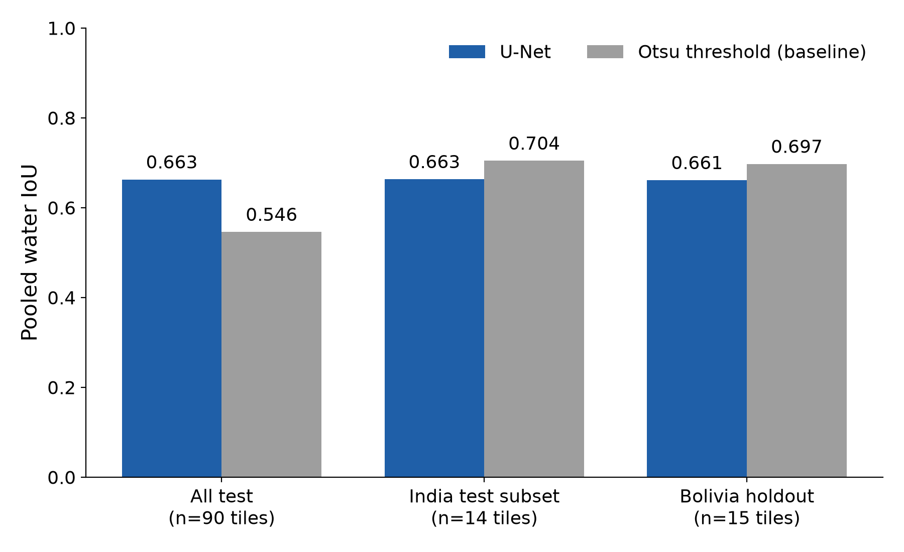
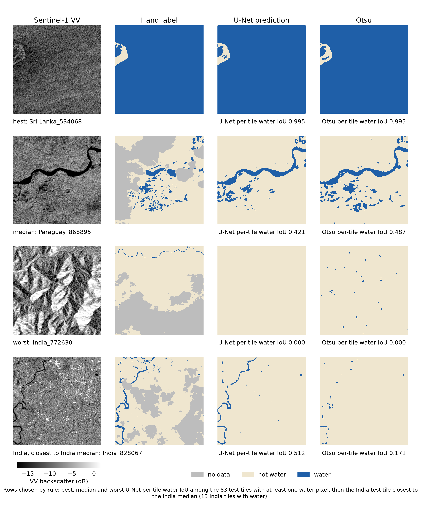
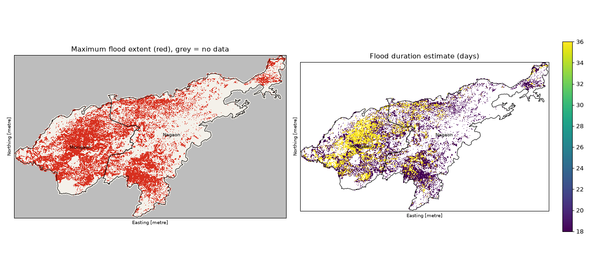
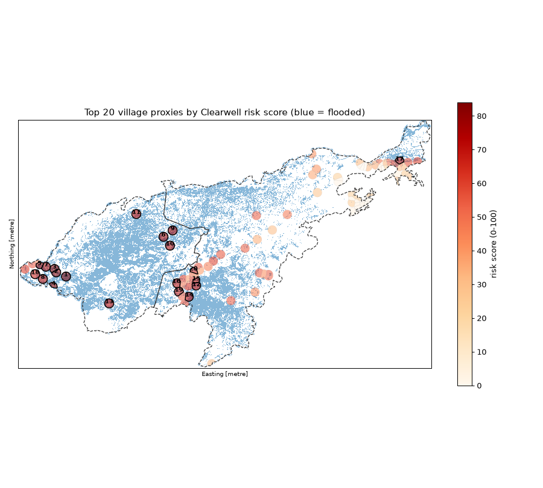
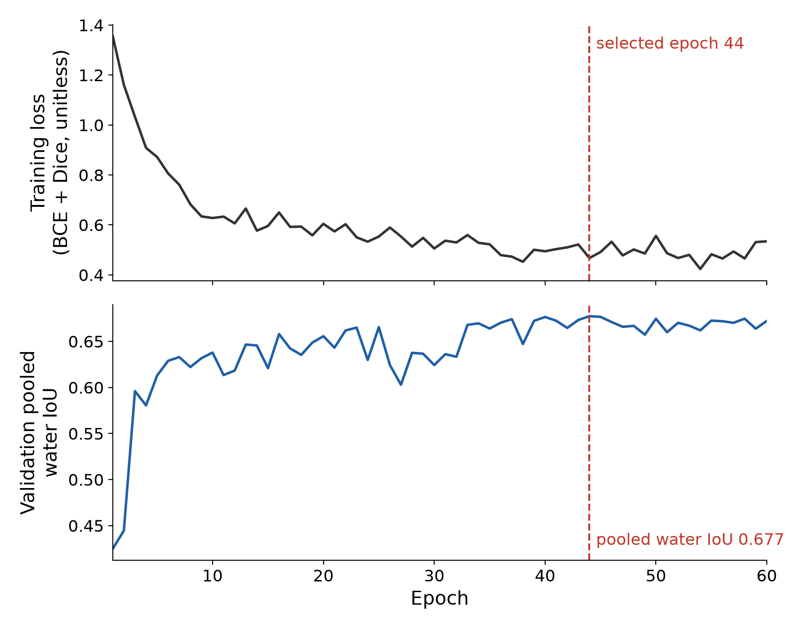
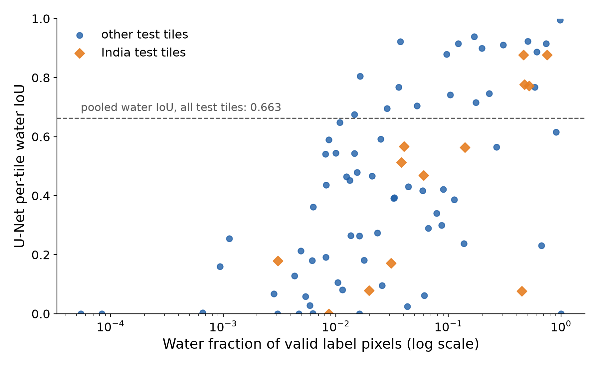

# Clearwell

Clearwell is a two-model system for flood-prone Assam, India. Model 1 maps floods from Sentinel-1 radar images, and Model 2 ranks flooded villages by well contamination risk.

Entry for the Xylem Global Student Innovation Challenge 2026 (Challenge 2, Water Quality).

## What this project is

After a monsoon flood, health officials have hundreds of affected villages but only enough testing kits and chlorine for some of them. Clearwell has two parts:

1. **Model 1 (flood mapping):** a U-Net with a ResNet-34 encoder that turns Sentinel-1 radar images into water maps. It is trained and tested on the public Sen1Floods11 benchmark.
2. **Model 2 (risk ranking):** a transparent index that scores village-sized areas by how much flood water reached them, for how long, how many people live there, how much they rely on shallow wells, and how low the ground is.

How far each part is validated:

- Model 1 is scored on a public benchmark with held-out tiles.
- Model 2 is **not yet validated against real outcomes**. Only 2 districts were flood-mapped, which is too few to test the ranking against outbreak reports (details below).

## Results

### Model 1: water detection on Sen1Floods11 hand-labeled tiles

**Pooled water IoU of 0.663 on the 90-tile test split**, against 0.546 for the Otsu threshold baseline distributed with the dataset. IoU is the overlap between predicted and true water pixels divided by their union (1 is perfect).



| Group | Tiles | U-Net | Otsu baseline |
|---|---|---|---|
| All test | 90 | 0.663 | 0.546 |
| India test subset | 14 | 0.663 | 0.704 |
| Bolivia holdout (country never seen in training) | 15 | 0.661 | 0.697 |

Results Interpretations:

- The U-Net beats the Otsu baseline only on the full test set. The India subset is only 14 tiles, so that comparison is uncertain.
- The IoU number depends on the definition. The same predictions score 0.663 as pooled water IoU, 0.805 as the mean over both classes (water and not water), and 0.408 as the average of per-tile IoUs (low because tiles with little water score near 0). Only compare with other papers that use the same definition.
- The test split was scored 3 times in total (1 on an early epoch-7 checkpoint, 2 on the final one). Hyperparameters were chosen on the validation split only. Full detail: [results/model1_RESULTS.md](results/model1_RESULTS.md).

Fixed-rule examples (best, median and worst test tile by IoU, plus the India tile closest to the India median). Predictions are drawn over the whole tile, but only pixels with a valid label are scored.



### Applying it to Morigaon and Nagaon districts, July to August 2019 flood

- **787.0 km2** of flooded area mapped (Morigaon 440.7, Nagaon 346.3), excluding normal-year water, from 2 Sentinel-1 passes (2019-07-23 and 2019-08-10).
- Flooded pixels sit closer to normal water and lower in elevation than random land pixels: mean distance to normal water 201 m vs 378 m, mean elevation 56.8 m vs 77.6 m (permutation p = 0.005 for both).
- Independent check against optical imagery: IoU 0.402 on clear pixels against a Sentinel-2 image from 2019-08-12. This is clearly lower than the benchmark score above.
- The normal-water mask agrees poorly with the JRC Global Surface Water product: IoU 0.117, pixel agreement 0.840. I have not investigated why.
- The radar imagery in Assam differs from the training imagery (different processing, different brightness statistics, see the table below), so the benchmark scores may not carry over to Assam.



### Risk ranking: 110 village proxies

- 110 village-sized areas (Voronoi cells around OpenStreetMap village points) were ranked from 0 to 100.
- After the first satellite pass alone, 45 of the final top 50 were already in the top 50. With only 2 passes available this is a weak test of how early the ranking is useful.
- All of the top 10 areas have the same flood duration value (36 days), because only 2 passes exist, so duration cannot separate them.
- **Validation against outbreak reports is not possible yet.** IDSP outbreak reports were matched to districts, but only 2 districts were mapped, so the district-level Spearman correlation is undefined (n = 2). A district-week check on 14 rows with 3 outbreak weeks gave AUC 0.545 for the index and 0.273 for flooded area or exposed population alone. That is too little data to conclude anything.



The ranked list is a prototype output. It has not been checked against ground truth and should not be used to decide where to send supplies.

## How it works

### Model 1

- **Data:** Sen1Floods11 hand-labeled tiles (Bonafilia et al., 2020), 446 tiles in total: 252 train, 89 validation, 90 test and 15 Bolivia holdout. Inputs are Sentinel-1 VV and VH backscatter in dB.
- **Preprocessing:** dB values are clipped to a fixed range, then standardized with the VV and VH mean and standard deviation of the training tiles. The same numbers are reused unchanged for Assam ([results/norm_stats.json](results/norm_stats.json)).
- **Model:** U-Net with a ResNet-34 encoder (ImageNet weights), 2 input bands.
- **Training:** BCE plus Dice loss with no-data pixels ignored, random 256 px crops, flips and 90 degree rotations, AdamW with a cosine schedule, mixed precision, batch size 8, up to 60 epochs. The decoder and head start at a learning rate of 3e-4 and the encoder at 0.1 times that (3e-5), the `lr0.0003_enc0.1x` setting that scored best on the validation split in [results/model1_sweep.md](results/model1_sweep.md). The `learning_rate` value in `results/model1_train_summary.json` is the rate at the last epoch after the cosine decay, not the starting rate. The selected checkpoint is epoch 44, which had the best validation IoU (0.677). Early stopping did not trigger. One full training run took 96 seconds on an RTX 3080.
- **Evaluation:** a pixel is water if the predicted probability is at least 0.5. IoU is pooled: true positives, false positives and false negatives are summed over all valid pixels of a group, then one IoU is computed. Code: `train.py` and `eval_protocol.py`.
- **Baseline:** the Otsu threshold labels that ship with Sen1Floods11 (`S1OtsuLabelHand`). They are read from the dataset, not computed by this repo.



Per-tile IoU against the fraction of water in the tile, which explains why the per-tile mean is low:



### From radar images to flood maps (Assam)

- **Normal water:** a pixel counts as normal water if the U-Net calls it water in at least half of the normal-year passes (2018 and 2021 monsoon passes).
- **Flood:** water in a flood-window pass and not normal water. Blobs smaller than 0.5 ha are removed.
- **Duration:** the longest run of consecutive flooded passes. A run from pass i to pass j counts as (date j minus date i) plus one revisit interval, so with 2 passes 18 days apart the possible values are few.
- **Radar source mismatch:** Sen1Floods11 radar is Earth Engine GRD (sigma0). The Assam imagery is Planetary Computer RTC (gamma0, terrain flattened).

| Radar data | VV mean (dB) | VV std | VH mean (dB) | VH std |
|---|---|---|---|---|
| Sen1Floods11 train | -10.39 | 4.03 | -17.24 | 4.75 |
| Assam normal years | -8.91 | 4.57 | -15.27 | 4.07 |
| Assam flood window | -9.70 | 5.21 | -16.37 | 4.61 |

Flood-window imagery contains more water, so a lower mean is expected even without a sensor difference.

### Model 2: the risk index

- **Units:** Census 2011 village boundaries are not freely downloadable, so units are Voronoi cells around OpenStreetMap village and hamlet points, clipped to the district and to 1.5 km. They are called village proxies throughout.
- **Components:** flooded share, flood duration, people in the flooded area (WorldPop), shallow-well reliance and low elevation. Each becomes a percentile rank from 0 to 1, except shallow-well reliance, which is used as a share (percent divided by 100). The components are then combined as a weighted sum scaled to 0 to 100. Weights are in `config.py` and are assumptions, not learned. The shallow-well reliance values come from a hand-filled district-level table, `data/manual/census_water.csv`: 92.1% for Morigaon and 85.4% for Nagaon, so every village proxy in a district gets the same value. That file does not record where its numbers came from, and `data/` is not committed, so the source cannot be checked from this repo.
- **Validation design:** no model is trained on outbreaks. The index and three simple baselines (flooded area alone, rainfall alone, people in flooded area alone) are compared with IDSP outbreak counts using Spearman correlation, permutation p-values and bootstrap intervals, plus a district-week check. The five weights in `config.py` have not changed since they were first committed on 2026-11-12, before the outbreak file was first used (validate stage, 2026-11-15 12:49). One related setting did change after that first use: later on 2026-11-15, shallow-well reliance was switched from a percentile rank to a share, with its weight unchanged at 0.15 (reason in `DECISIONS.md`).

### Limits

- Sentinel-1 revisits a place every 6 to 12 days, so flash floods between passes are invisible.
- The U-Net finds water, not floods. Flooded paddy fields and seasonal wetlands are handled only by subtracting normal-year water.
- Village proxies are not census villages, and population is modelled, assuming people are spread evenly within each 100 m cell.
- IDSP lists reported outbreaks only, so under-reporting looks like no outbreak.
- The India test subset has only 14 tiles.

## Future steps and open questions

- **Why does Otsu beat the U-Net on the India and Bolivia tiles?** The India subset is small. A larger regional test set, or a per-region error analysis, would show whether this is noise or a real gap.
- **Match the metric to published work.** The repo reports pooled water IoU. I have not yet matched this definition against published Sen1Floods11 results.
- **Measure the effect of the Assam radar mismatch.** Compare against a model fine-tuned on imagery processed the same way as the Assam data.
- **Validate the ranking.** Flood-map more districts so that a district-level comparison with outbreak reports has enough points.
- **More passes.** With only 2 passes, duration and the early-ranking test say little. Add rainfall and river gauge data to fill gaps between passes.
- Fine-tune on Kuro Siwo, a larger flood dataset (first check how much of it covers South Asia).
- A change-detection model that looks at pre-flood and during-flood images together.
- Real village boundaries if they become available, plus sanitation data as a contamination-source component.

## Reproduce

Windows (PowerShell), Python 3.12, an NVIDIA GPU.

```powershell
git clone https://github.com/Matthew-Goley/xylem-ClearWell.git
cd xylem-ClearWell
py -3.12 -m venv .venv
.venv\Scripts\Activate.ps1
python -m pip install --upgrade pip
pip install torch torchvision --index-url https://download.pytorch.org/whl/cu124
pip install -r requirements.txt
python run_all.py --smoke
python run_all.py
```

Pick the PyTorch `--index-url` that matches your CUDA version at <https://pytorch.org/get-started/locally/>. Install torch before `requirements.txt`.

The trained epoch-44 checkpoint is on the [Releases page](https://github.com/Matthew-Goley/xylem-ClearWell/releases/tag/model1-v1). SHA256: `b42facd16f14b86eba9c39a4b128a386f9d2510ec4447ef4b4b876eace2e1a46`. It is a PyTorch file, so only load checkpoints from sources you trust.

| File | What it does |
|---|---|
| `config.py` | All settings: paths, region, dates, model settings, risk weights |
| `train.py` | Sen1Floods11 download, normalization, U-Net training, test against Otsu |
| `eval_protocol.py` | Re-scores the saved checkpoint under the definitions listed above |
| `export_s1.py`, `flood_map.py` | Sentinel-1 download for Assam, flood maps and duration |
| `build_villages.py`, `risk_score.py` | Village proxies and the risk index |
| `validate_risk.py` | Comparison with outbreak reports and simple baselines |
| `summary.py` | Writes [results/SUMMARY.md](results/SUMMARY.md) from the result files |
| `results/` | Small committed outputs (json, md, csv, png) |
| `DECISIONS.md` | One line per design decision the spec left open |

Full pipeline status: [results/STATUS.md](results/STATUS.md).